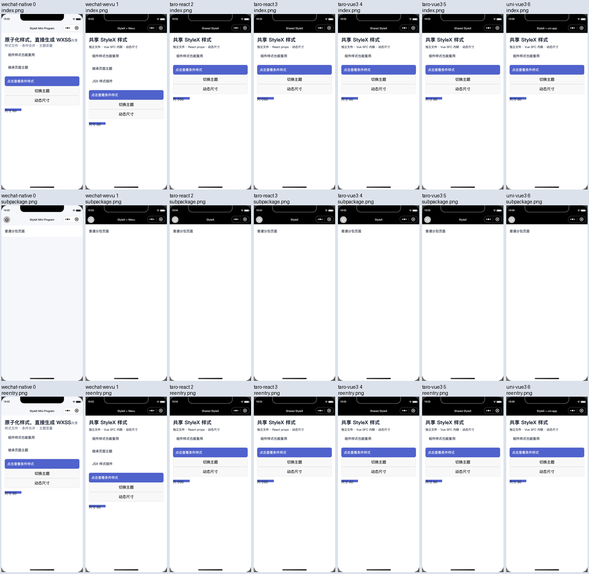

# 2026-11-03 依赖升级验证证据

这里提交本轮依赖审查、最终本地矩阵、消费者、Linux 与 IDE 诊断的 33 份白名单 JSON/日志证据，以及 21 张 IDE 截图和 1 张审查用总览图。不包含测试身份、原始账户、认证状态、完整 node_modules 或源码树。远程 CI/CD 以 [PR #13 最新提交 checks](https://github.com/weapp-stylex/weapp-stylex/pull/13/checks)为准，全部通过方可合并；本目录中的单个通过报告不能替代其他门禁。

| 文件                                                                                                                                                                       | 用途                                                                                                                   |
| -------------------------------------------------------------------------------------------------------------------------------------------------------------------------- | ---------------------------------------------------------------------------------------------------------------------- |
| [audit-before.json](./audit-before.json)                                                                                                                                   | 升级前 pnpm audit 原始数据：128 个 advisory                                                                            |
| [audit-intermediate-76.json](./audit-intermediate-76.json)                                                                                                                 | 中间阶段快照，保留追加兼容补丁前的 76 项结果                                                                           |
| [audit-after.json](./audit-after.json)                                                                                                                                     | 最终冻结依赖审计：3 critical、10 high、37 moderate、9 low，共 59 项                                                    |
| [compatible-patch-evaluation.json](./compatible-patch-evaluation.json)                                                                                                     | 补丁选择前的官方包版本、engines、依赖及实际父包声明，含查询时间                                                        |
| [intlify-exports.json](./intlify-exports.json)                                                                                                                             | 官方 core-base 9.1.11 / 9.14.5 tarball 与 DCloud 旧 Vue I18n 实际导出需求对照                                          |
| [security-override-apis.json](./security-override-apis.json)                                                                                                               | 最终 31 份真实安装副本、29 包、2 个 Express 上下文及 DCloud 导入契约的 API 验证                                        |
| [minimist-evaluation.json](./minimist-evaluation.json)                                                                                                                     | minimist 参数语义对照，以及 mkdirp 父包补丁的 CLI、权限、同步/异步和真实 Jimp 验证                                     |
| [watch-diagnostic-summary.json](./watch-diagnostic-summary.json)                                                                                                           | Linux watcher 等待器接受前一轮 END 的事件序列、7.4 对照与修复边界                                                      |
| [weapp-vite-7.8-linux-synthetic-success.json](./weapp-vite-7.8-linux-synthetic-success.json)                                                                               | 官方宿主实际生成长 synthetic sidecar ID 后成功构建的 Linux 报告                                                        |
| [watch-atomic-save-repro.json](./watch-atomic-save-repro.json)                                                                                                             | 两个官方宿主都读取到 writeFile 截断空输入的原始事件、空内容 SHA-256 与各自底层版本                                     |
| [watch-diagnostic-atomic.json](./watch-diagnostic-atomic.json)                                                                                                             | 原子写入后 7.4 / 7.8 各 20 轮严格 watch 对照通过；两组底层 Vite/Rolldown 版本不同                                      |
| [weapp-vite-7.8-linux-integration.json](./weapp-vite-7.8-linux-integration.json)、[原始日志](./weapp-vite-7.8-linux-integration.log.txt)                                   | 664.56 秒完整 Linux integration，属于安全补丁完成前的等待器诊断快照                                                    |
| [weapp-vite-7.8-linux-integration-atomic.json](./weapp-vite-7.8-linux-integration-atomic.json)、[原始日志](./weapp-vite-7.8-linux-integration-atomic.log.txt)              | 原子写入修复后最终测试输入的完整 Linux integration，473.25 秒，exit 0                                                  |
| [final-prepare-summary.json](./final-prepare-summary.json)                                                                                                                 | 最终冻结安装、库构建、类型、lint、单元、依赖、doctor、repo check 和打包的逐步结果                                      |
| [final-repack-summary.json](./final-repack-summary.json)                                                                                                                   | 原子写入修复后再次冻结安装、lint、100 项脚本测试和同批六包 tarball                                                     |
| [final-matrix-summary.json](./final-matrix-summary.json)                                                                                                                   | Babel / auto 各 28 构建与产物、H5、最低宿主、完整 integration；10 个命令 exit 0、锁未变                                |
| [library-packs-final2.json](./library-packs-final2.json)                                                                                                                   | 最终共同使用的六包 tarball、SHA-256、pack ID、run ID 与打包时源文件清单                                                |
| [framework-consumers-final2.json](./framework-consumers-final2.json)                                                                                                       | facade / adapter、新旧 DCloud 的 120 次真实构建汇总，同 pack ID、锁哈希与六个原始 manifest 来源                        |
| [facade 全矩阵](./framework-consumer-facade-all.json.gz)、[旧通道微信](./framework-consumer-facade-weapp.json.gz)、[旧通道 H5](./framework-consumer-facade-h5.json.gz)     | 三份 facade 原始 manifest，仅保留完整 gzip，56 + 2 + 2 次真实构建                                                      |
| [adapter 全矩阵](./framework-consumer-adapter-all.json.gz)、[旧通道微信](./framework-consumer-adapter-weapp.json.gz)、[旧通道 H5](./framework-consumer-adapter-h5.json.gz) | 三份 adapter 原始 manifest，仅保留完整 gzip，56 + 2 + 2 次真实构建                                                     |
| [floor-22.22.1.json](./floor-22.22.1.json)、[floor-24.11.0.json](./floor-24.11.0.json)                                                                                     | 可发布库两个最低 Node 版本的六包独立入口、ESM/CJS、types、Babel/auto/SWC 与无 addon 消费者                             |
| [docs-browser-stable.json](./docs-browser-stable.json)、[docs-browser-preview.json](./docs-browser-preview.json)                                                           | 稳定/预览生产文档的后台浏览器交互验证与本任务资源关闭状态                                                              |
| [ide-sanitized.json](./ide-sanitized.json)                                                                                                                                 | 最终 auto/direct 七产物真实 IDE 验收：381 条计算样式检查、同 final2 pack、基础库与全部任务资源关闭；原始账户字段已移除 |
| [ide-startup-diagnostic.json](./ide-startup-diagnostic.json)                                                                                                               | preopen 失败、direct 对照及日志支持的可能解释；保留失败，区分原快照和后续清理观察                                      |
| [ide-screenshot-review.json](./ide-screenshot-review.json)                                                                                                                 | 21 张真实页面截图的视觉/隐私人工审查、源文件、尺寸、字节与 SHA-256；包含总览图校验                                     |
| [manifest.json](./manifest.json)                                                                                                                                           | 每份证据的原始字节数、SHA-256、gzip 归档校验与可读 JSON 校验                                                           |

可读 `.json` 允许仓库 formatter 调整缩进和键顺序；每个同名 `.gz` 都保存采集时的完整原始字节，未经过 JSON parse/stringify。`manifest.json` 分别记录原始数据、归档文件和可读文件的校验值。可读 JSON 已验证与原始字节解析出的数据相同，原始日志则按字节相同校验。六份完整消费者 manifest 仅存 gzip，避免提交重复可读副本；它们的原始字节数、SHA-256 和归档校验值同样列在 manifest 中。

IDE 报告在进入归档前已脱敏，因此其 gzip 只保存脱敏源文件的字节，不包含原始 account/protocol 响应。未脱敏报告只以 SHA-256 标识来源。21 张 PNG 与总览图已获人工视觉和隐私审查，按原始字节直接保存；`manifest.json` 的 `media` 数组记录图像校验值，不为 PNG 再生成重复 gzip。

本地最终矩阵、120 次框架消费者与两个最低 Node 消费者使用同一个 final2 pack ID。Linux 记录用于确认官方宿主、真实 synthetic ID 和本仓库测试修复，较早的 664.56 秒记录不能当成最终安全补丁矩阵。报告中的绝对路径是采集环境来源标识；提交目录内的 gzip 才是可独立复核的原始证据，完整后续 CI 日志另由 Actions artifact 保存。

以下图片均来自官方稳定 IDE `2.02.2609240`、基础库 `3.17.6` 的最终 direct 完整运行。每个产物保留首页、普通分包与返回重入三张截图；截图提供视觉证据，计算样式与交互断言见完整报告。

| 产物               | 首页                                     | 普通分包                                           | 返回重入                                     |
| ------------------ | ---------------------------------------- | -------------------------------------------------- | -------------------------------------------- |
| 原生               | [index](./ide/0-wechat-native/index.png) | [subpackage](./ide/0-wechat-native/subpackage.png) | [reentry](./ide/0-wechat-native/reentry.png) |
| Wevu               | [index](./ide/1-wechat-wevu/index.png)   | [subpackage](./ide/1-wechat-wevu/subpackage.png)   | [reentry](./ide/1-wechat-wevu/reentry.png)   |
| Taro React Webpack | [index](./ide/2-taro-react/index.png)    | [subpackage](./ide/2-taro-react/subpackage.png)    | [reentry](./ide/2-taro-react/reentry.png)    |
| Taro React Vite    | [index](./ide/3-taro-react/index.png)    | [subpackage](./ide/3-taro-react/subpackage.png)    | [reentry](./ide/3-taro-react/reentry.png)    |
| Taro Vue Webpack   | [index](./ide/4-taro-vue3/index.png)     | [subpackage](./ide/4-taro-vue3/subpackage.png)     | [reentry](./ide/4-taro-vue3/reentry.png)     |
| Taro Vue Vite      | [index](./ide/5-taro-vue3/index.png)     | [subpackage](./ide/5-taro-vue3/subpackage.png)     | [reentry](./ide/5-taro-vue3/reentry.png)     |
| uni-app Vue        | [index](./ide/6-uni-vue3/index.png)      | [subpackage](./ide/6-uni-vue3/subpackage.png)      | [reentry](./ide/6-uni-vue3/reentry.png)      |



例如验证原始审计响应：

```bash
gzip -dc docs/validation/dependency-upgrade-2026-11-03/audit-after.json.gz | shasum -a 256
```

结果应等于 manifest 中该文件的 `originalSha256`。归档采用 gzip level 9；它只用于证据字节保存，与小程序产物体积比较无关。

本轮审计并未清零。剩余风险、宿主版本约束与明确的 API 不兼容边界见[升级报告](../../dependency-upgrade-2026-11-03.md)。
